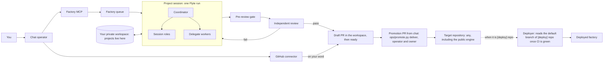

# Flyte Agent Factory

A software factory that runs on Flyte. You describe a change to a chat agent; the factory runs a long-lived
coding-agent session on it (Claude Code or Codex, your choice per role), checks the result with independent
reviewers, and delivers a reviewed pull request for you to merge.

The Python package is `flyte_agent_factory` and the distribution `flyte-agent-factory`.



One project is one Flyte run. The run has no time limit, takes direction and asks questions through Flyte
conditions, and is checkpointed, so a project can take the months a feature takes.

## Chat first

You use the factory through a chat agent, the operator: Claude with the factory MCP, the `agent-factory` skill
and GitHub's MCP server connected. It sits between you and the factory on purpose:

- **It answers the factory.** Sessions ask questions as they work. The operator answers the engineering ones and
  brings you only real decisions: product choices, tradeoffs, money, anything irreversible.
- **It holds the credentials the factory doesn't.** A session pushes only to the repository it was launched on
  and opens pull requests; it does not merge. (`[loop] merge = "on"` is an opt-in exception: it merges the loop's
  own passing pull requests on its `[loop] repo`, and needs the factory's GitHub App installed there, so it does not
  apply to a public engine repository you cannot install an App on.) Merging and promoting to another repository,
  the engine included, use your credentials, which only the operator holds, and only when you say so. Secrets
  mounted in the factory's own pods are not an isolation boundary: with `[board]` each project's supervisor mounts
  a token with repo scope ([profiles/README.md](profiles/README.md#projects-v2-board)).
  Deciding what is Ready on the board is yours too: by default the factory sets neither Ready nor Backlog (the
  settings that change that are listed in [docs/chat-operator.md](docs/chat-operator.md#what-each-side-can-do)).
- **It helps you write the inputs.** Issues and briefs are problem and requirements documents. The operator
  drafts them with you and leaves the design to the factory.
- **It explains.** Status, the queue, review findings, usage and why something stalled, in plain terms.

Setup, the full split of who can do what, and what to ask: [docs/chat-operator.md](docs/chat-operator.md).

## What it needs

- A Union backend for the current installer. OSS Flyte requires implementation changes before setup
  ([compatibility audit](docs/oss-flyte-compat.md)).
- A Claude `setup-token` as a Flyte secret; a personal Claude Pro or Max plan works. Optionally, for Codex, a
  ChatGPT login from a personal Plus or Pro plan, or a Codex access token from a Business or Enterprise workspace.
- A private GitHub repository of your own, the workspace, with a write deploy key. Sessions push there. Optionally
  (and by default in guided setup) your own GitHub App for draft pull requests, verifier statuses and auto-deploy
  ([docs/github-app.md](docs/github-app.md)). Work on another repository, the engine included, is imported into a
  workspace project and promoted back as a pull request ([promotion](docs/architecture-repos.md#promotion));
  sessions hold no credential for it.
- For the operator: Claude Code, or claude.ai where your organization has its request-header connectors (a beta),
  and a GitHub OAuth App or token for its GitHub connector.
- A deployment profile naming all of it: `profile.toml` at the root of your workspace. It holds every
  owner-specific value; none is in this repository.

Start with [guided setup](docs/quickstart.md): download `agent-factory.zip` and `since.zip` from
[`skills/dist/`](https://github.com/unionai-oss/flyte-agent-factory/tree/main/skills/dist), save them in claude.ai
(Settings, Capabilities, Skills) or unzip them into `~/.claude/skills/` for Claude Code, then run `/agent-factory`.
It asks for your Flyte endpoint, project, GitHub owner and state bucket, hands you one copy-paste command that does the
machine work (workspace from the bundled template, deploy key, your own GitHub App, ruleset, board, profile, deploy)
and resumes if interrupted, then connects the MCP and helps with your first launch. It never asks for a credential in
chat. Fresh installs currently follow the Union path; OSS runs every step except the deploy
(see the compatibility audit above).
Every secret is in [docs/secrets.md](docs/secrets.md).

Cost is your model usage plus Flyte compute. Usage meters and a per-account reserve decide when a launch may start.

## Using it, in five steps

1. **Set up once.** Install the skills and run `/agent-factory`, and the operator guides the install
   ([docs/quickstart.md](docs/quickstart.md)), then the connections
   ([docs/chat-operator.md](docs/chat-operator.md#setup)): the factory MCP, the skill, the GitHub connector.
2. **Launch.** Tell the operator what you want and what done means. It writes the brief and calls
   `factory.launch`, which queues the project and starts it when a slot is free.
3. **Watch and steer.** Ask how it is going. The operator reads `factory.status`, answers or relays the session's
   questions, passes on your direction, and stops it cleanly when you say so ([docs/operating.md](docs/operating.md)).
4. **Review.** When the session declares DONE, a deterministic gate runs, then three independent judges. With
   `[github]` in the profile the work arrives as a draft pull request on `factory/<name>`, marked ready when review
   passes; without it the session pushes the default branch and no pull request is opened. The operator tells you
   the result and explains any blocking findings.
5. **Merge and promote.** You decide; the operator merges. A project that delivers to another repository (a
   `Delivers to:` line) is imported into the workspace, worked on there and promoted to the target as a pull request by
   the operator, with your credentials: [Promotion](docs/architecture-repos.md#promotion).

The same tasks run without chat, for scripts and automation: `ops/operate.py` from a terminal, issues bearing the
intake label through the signed webhook ([docs/deploy-webhook.md](docs/deploy-webhook.md#issue-intake)), and a
direct `flyte run` of the `project` task, which skips the queue ([docs/operating.md](docs/operating.md#running-a-project)).

## Documentation

| You are | Start with |
|---|---|
| using it day to day | [docs/chat-operator.md](docs/chat-operator.md), then [docs/operating.md](docs/operating.md) |
| deciding whether to adopt it | [docs/architecture.md](docs/architecture.md): the loop, the roles, git flow, what is pluggable |
| installing it for the first time | [docs/quickstart.md](docs/quickstart.md), [docs/secrets.md](docs/secrets.md) |
| setting up a workspace | [docs/setup.md](docs/setup.md), then [docs/chat-operator.md](docs/chat-operator.md#setup) |
| changing the engine | [docs/contributing.md](docs/contributing.md), [docs/architecture.md](docs/architecture.md#where-things-live) |

[docs/README.md](docs/README.md) indexes every page by audience.

## Develop

```bash
PYTHONPATH=src uv run python -m pytest tests -q && uv run ruff check src tests ops && uv run ruff format --check src tests ops
export AGENT_FACTORY_SECRETS="$(PYTHONPATH=src uv run python -m flyte_agent_factory._profile agent_secrets)"
```

The tests need no cluster, subscription or profile. The `export` is not a test prerequisite: it needs a deployment
profile (`AGENT_FACTORY_PROFILE`) and is a first-install step, described with the rest of the deploy commands in
[docs/setup.md](docs/setup.md).

## Contributing, security and license

- [Contributing](docs/contributing.md): setup, the checks, tests first, and the DCO sign-off.
- [Security policy](docs/security.md): report vulnerabilities privately; never put credentials in issues.
- [Apache License 2.0](LICENSE).
