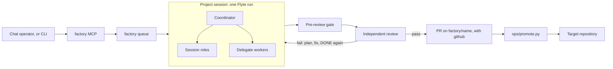

# Architecture

How the Flyte Agent Factory works, for someone deciding whether to use it, running it, or changing it. Setup is in
[setup.md](setup.md); day-to-day commands are in [operating.md](operating.md).



## How a person interacts with the factory

You talk to the factory through a chat operator: Claude, with the factory MCP connected, the `agent-factory` skill
installed and GitHub's MCP server as a second connector. That is the default, and the operator does more than relay:
it answers the questions it can, holds the credentials the factory does not (merging, promoting), sets the
board's Backlog and Ready on your word, helps you write issues and briefs, and explains status
([chat-operator.md](chat-operator.md)).
`ops/operate.py` reaches the same Flyte tasks from a terminal, for scripts and automation.

| You want to | Chat | Terminal |
|---|---|---|
| start or resume a project | `factory.launch` | `ops/operate.py launch` |
| see what runs and what waits | `factory.queue_list` | `ops/operate.py overview`, `running`, `queue` |
| see how one project is doing | `factory.status` | `ops/operate.py status` |
| remove a waiting launch | `factory.queue_cancel` | `ops/operate.py cancel` |
| send direction, answer a question, stop | `list_conditions`, `signal_condition` | `ops/operate.py answer`, `flyte signal condition` |

A running project exposes two kinds of Flyte condition, named `direct-a<attempt>-NNN` and `ask-a<attempt>-NNN`
(`flyte get condition` or `list_conditions` shows the exact names). A `direct-` condition is its inbox: signal it with
a message and the coordinator receives it; `/stop`, `stop` or `/exit` saves the workspace and ends the project. An
`ask-` condition is a question the session opened with `ask-human` that the factory judged to be the owner's (an
engineering-judgement question is decided in the factory and opens no condition); every question carries a timeout
and a default the session takes if nobody answers. Nothing blocks on a person. The run report (`factory.status` reads it) shows the current activity, the timeline, open questions,
review state, the PR link and the usage meters.

## How work is driven through git

Three repositories are involved ([architecture-repos.md](architecture-repos.md) has the detail).

| Repository | Role in the flow | Who writes it |
|---|---|---|
| the engine | the factory's code; deployments run a pinned release | maintainers, by pull request |
| your workspace | `standards/`, `profile.toml`, `waivers.toml`, `gardening.toml`, and `projects/<name>/` | you; the factory writes a project's own directory under `projects/` |
| a target repository | where finished work is delivered | you, by running `ops/promote.py` |

1. **Launch.** A launch names a project, a brief and a repository. The factory validates it and writes it to the
   queue; it starts when a slot is free.
2. **Work on a branch.** With `[github]` in the profile, the session works on branch `factory/<name>` and pushes
   it with the deploy key of the repository it was launched on (the workspace, or the engine repository for a
   factory-improvement launch, which needs a `[repo_keys]` entry). Without `[github]` it stays on the default branch
   and pushes that. Where the project's files are depends on the repository's layout: `projects/<name>/` in a
   workspace (a repository whose root has `projects/`), `<name>/` in a shared sandbox repository, the whole
   repository for any other ([architecture-repos.md](architecture-repos.md#where-a-project-works)). A `pre-push`
   hook refuses a push to any other URL; it checks the URL, not the branch.
3. **Draft PR on DONE.** When the coordinator declares DONE, the supervisor opens a draft pull request (ready, where
   the repository has no drafts). A DONE that fails the pre-review checks goes back to the session in seconds and
   spends no review round.
4. **Ready on pass.** When review passes, the PR is marked ready with a verdict comment and a `factory/verifier`
   commit status on the reviewed commit. A review that fails or escalates sets that status to failure. The factory
   does not merge, except that with `[loop] merge = "on"` the loop merges a passing pull request on the engine
   repository. Making `factory/verifier` a required check is the owner's branch protection
   ([branch-protection.md](branch-protection.md)).
5. **Promote.** A project whose brief has a `Delivers to:` line leaves `projects/<name>/patches/*.patch`, made by
   the session with `git format-patch` and checked by the gate's `factory:target-patches`.
   `ops/promote.py <workspace> <project> <target-url> <branch>` applies them to a new branch of the target with
   `git am --3way`, runs the target's own CI commands and the changed-line coverage check (changed Python lines;
   those listed in the project's `SUMMARY.md` are excused, and the file is the PR body), and pushes a branch and a
   PR with your credentials. You run it from a machine with a shell; the factory MCP has no promote task, and the
   factory holds no credential for the target. `--dry-run` does everything but push.

Who may change what is fixed by the gate, not by convention. `standards/` is read-only to the factory: the gate
rejects any project change to it, and the session is told so. `waivers.toml` and `gardening.toml` are owner-only
in the same way; a waiver is always the owner's decision ([contributing.md](contributing.md#owner-waivers)).

## The controls on the MCP

The factory MCP is Flyte's stock `FlyteMCPAppEnvironment` behind Union sign-in, so every call runs as the caller and
Union RBAC applies ([factory-mcp-setup.md](factory-mcp-setup.md)). The server exposes every tool the stock app has
(`TOOLS` in `_factory_mcp.py`, all 32). Their scope is the factory's project and domain, enforced by the server's own
project/domain check: a call naming another project or domain is refused before any request to Union, and
`list_projects` shows only the factory project. What the caller may do inside that scope is bounded by the caller's
Union auth (the RBAC of the bearer token or API key).

| Tool | What it does |
|---|---|
| `run_task` | starts any task registered in the factory project and domain (those below are the ones chat is steered to) with the inputs you give |
| `get_task` | reads a task's definition and inputs |
| `list_tasks` | lists the registered tasks |
| `get_run` | reads a run's phase and metadata |
| `get_run_io` | reads a run's inputs and outputs; waits up to 90 seconds for outputs that Union's read model has not caught up on |
| `wait_for_run` | waits for a run to end, with the same patience for outputs |
| `list_runs` | lists runs, filtered by task name |
| `list_actions` | lists the actions of a run |
| `get_action` | reads one action, including its error info |
| `get_logs` | reads an action's logs |
| `list_conditions` | lists a run's open conditions (`ask-` questions and `direct-` inboxes) |
| `signal_condition` | answers a condition: an answer to a question, or direction to a project |
| `abort_run` | aborts a run; unsaved work is lost, so prefer `/stop` through `direct-NNN` |
| `rerun_run` | starts a run again with the same inputs |
| `abort_action` | aborts one action of a run |
| `list_apps`, `get_app` | list and read the factory's apps |
| `activate_app`, `deactivate_app` | turn an app on or off |
| `list_triggers`, `get_trigger` | list and read the factory's triggers (the queue sweep, for one) |
| `activate_trigger`, `deactivate_trigger` | turn a trigger on or off |
| `list_projects`, `get_project` | show the factory project only; `get_project` refuses any other name |
| `list_secrets` | lists secret names and types; no tool returns a secret value |
| `create_secret`, `delete_secret` | write or remove a secret; the value is never echoed back. Engine credentials are not set this way: they are stored with local commands ([quickstart §4](quickstart.md#4-store-engine-credentials-locally)), never sent through chat |
| `search_flyte_sdk_examples`, `search_flyte_docs_examples`, `search_full_docs` | search the Flyte SDK examples, the Union examples and the Union docs, which the app image carries in `/opt/flyte-mcp-docs` |
| `whoami` | shows which identity the calls run as |

`run_task` can start any task in the factory project and domain. The instructions steer chat to these (`CHAT_TASKS`,
plus the benchmark and the Codex sign-in); running a slot task directly is unsupported, not blocked, because
started directly it skips validation and the queue. After a failed deploy, chat can start
`factory-deployer.deploy_if_changed` (no inputs) instead of waiting for the next tick.

| Task | What it does |
|---|---|
| `factory.launch` | validates a launch (name slug, brief size, repository allowlist, model, `priority`, optional `issue`, optional `browser` grant) and queues it; starts at once if a slot is free |
| `factory.status` | the run report of a project: activity, timeline rows, questions, review, PR URL, meters, snapshot age |
| `factory.queue_list` | the live projects, the waiting launches in order, recent closed ones, and any usage reserve holding a launch back |
| `factory.queue_cancel` | removes a waiting launch |
| `factory.set_reserve` | sets an account's usage reserve (`k`; 0 removes it) |
| `factory.get_reserve` | reads every account's reserve |
| `factory.rotate_token` | after the token secret is replaced: sends `/stop` to every live project and queues one resume of each (reason `token rotated`), which starts on a new pod once the old run has ended |
| `factory.browser_link` | returns `{identity, url}`: a one-time (ten minutes, single use) sign-in/view link for a configured browser identity |
| `factory.credential_link` | returns `{project, credential, hours, url, paste_to}` for a live project: the link where the owner seals a credential for it, and its `direct-` condition to signal the sealed text to; no credential passes through it ([credential grants](credential-grants.md)) |
| `factory.credentials` | lists every live project's credential grants (name, kind, state, expiry), never a value |
| `factory-bench.benchmark` | measures one engine commit on a fixed task suite; spends nothing until given `max_usd` |

A project's credential grants (AWS access the owner gives one project for a time) are controlled from chat with
the two tasks above, `/revoke-credential` sent to the project's `direct-` condition, and the sealed text pasted
into a project's `ask-` question (or its `direct-` condition); the supervisor holds the credential in memory only. See
[credential-grants.md](credential-grants.md).

Other tasks in the same environment, which chat can start but is not steered to: `factory.sweep` (every five minutes, dispatches the queue after a
crash or lost hand-off), `factory.garden_weekly` (queues the weekly gardening project), `factory.plan_pass` (the
planner-admission pass) and `factory.read_login_meter` (reads an account's usage meter).

## The roles

### Session roles

The coordinator is the project's one long-lived session. It has in-process sub-agents, defined in
`.claude/agents/`, that run inside its container, share its workspace and cost nothing extra. They are named for the
verb. `product`, `designer`, `dev` and `qa` remain as aliases until the next minor release.

| Role | Old name | Triggered when | Writes |
|---|---|---|---|
| `scope` | `product` | a project starts, or the brief is ambiguous or drifting | the acceptance criteria draft (`ACCEPTANCE.md`) |
| `discover` | | a problem-brief issue, or a design question whose answer is not in the code | `DISCOVERY.md`: problem, evidence, needs, success measures, the owner interview or its timed-out default |
| `prototype` | | a choice between shapes a person will see or use (UI, report, CLI, API) | `prototypes/` with at least two different ones, and an evaluation with screenshots |
| `shape` | `designer` | scope is agreed and before building, or when a design fights the problem | `DESIGN-RATIONALE.md`: the decision, what was rejected and why |
| `build` | `dev` | the shape is settled | code and tests |
| `verify` | `qa` | after any build; several at once, on different aspects | verdicts that cite evidence |

A Codex coordinator has no sub-agents and uses `delegate` instead ([engines.md](engines.md)).

### Delegate workers

| Role | Triggered when | Output |
|---|---|---|
| `delegate` | the coordinator runs `delegate "<brief>"` (up to `DELEGATE_MAX` at once) | a patch and a summary in `.claude-flyte/delegations/`, or with `--answer` a read-only answer |

A worker runs in its own container on a snapshot of the workspace, including uncommitted changes, and never edits the
session's workspace. The coordinator reviews the patch, applies it with `git apply --3way`, runs the checks and
commits. It is accountable for every patch.

### Review-loop roles

When the coordinator declares DONE, the **pre-review gate** runs first. It is deterministic and spends no model
call. In order:

1. the demo package, when the launch asked for one;
2. the readiness preflight: `ACCEPTANCE.md` is written and not empty, no tracked file is dirty, the project's
   `checks.sh` is committed, and the branch has an upstream with nothing unpushed;
3. the project's own `checks.sh`;
4. the gate, `_gates.run`: `attribution` (every project commit carries the project's identity), `scope` (the edit
   scope), `factory:fail-to-pass` (the fail-to-pass test gate), `uncommitted`, then the checks the workspace's
   standards declare (see [standards.md](standards.md)): each rule's `Enforced:` line says whether it is judged by
   reviewers, mapped to a built-in `factory:` check (`factory:fail-to-pass`, `factory:module-size`,
   `factory:language-summary`, `factory:ui-evidence`; one that no rule maps does not run) or run as a command, a ruff
   code selection, a forbidden pattern or the workspace's own script. `factory:suppressions` runs whenever a MUST
   rule selects ruff codes. Built-in checks name the rules that map them in their output (`[QA-7]`), and a waiver
   may name the check or any of those rules. With no standards configured the gate records `factory:standards`
   (not applicable). For a project that delivers to another repository there are also `factory:target-ci`,
   `factory:target-coverage` and `factory:target-patches`.

   A MUST rule enforced by evidence (`Enforced: tool` with no command, such as the real-browser check for a UI)
   reports "no project command configured" until the project declares the command that satisfies it, in
   `factory-evidence.toml` at the project root:

   ```toml
   [evidence]
   "<RULE-ID>" = "npx playwright test --reporter=line"
   ```

   The gate runs it in the project directory, with the rule's `Timeout:` if it has one, and passes on exit 0. A
   command declared for a rule that is not an evidence rule, or a file that cannot be read, fails
   `factory:evidence`: the file supplies a missing check, it never replaces a rule's own.

   The target repo's commands (`factory:target-ci`, and the test run of `factory:target-coverage`) run as a GitHub
   runner would, not in the pod's environment: `PATH`, `HOME`, `LANG`/`LC_*`, `TMPDIR` and the like, `CI=true`,
   `GITHUB_ACTIONS=true`, `RUNNER_*`, `GITHUB_WORKSPACE`, `GITHUB_REPOSITORY`, `GITHUB_SHA`, `GITHUB_REF`,
   `GITHUB_EVENT_NAME=pull_request` and real per-job `GITHUB_OUTPUT`, `GITHUB_ENV`, `GITHUB_PATH` and
   `GITHUB_STEP_SUMMARY` files, then the workflow's, job's and step's `env:` and what earlier steps exported. Nothing
   else of the pod reaches them (no `_U_*`, `FLYTE_*`, `USER_LOG_LEVEL`, `AGENT_FACTORY_*`, credentials). A job that
   sets up Rust (`dtolnay/rust-toolchain`, `actions-rs/toolchain`, `rustup` or `cargo` in a step) uses the installed
   `cargo` (also `~/.cargo/bin`), else rustup is installed with the named toolchain and components into
   `~/.cache/flyte-agent-factory/rust`. If that cannot be done (no network), the command is reported `NOT RUN`
   with the reason: the status is `not run`, which does not block and is not a pass. When a command fails, the same
   job is run in the same environment on the unpatched base (the checkout's merge-base with its default branch);
   a failure the base has too (same exit code, no failing test or finding the base lacks, or the same normalised
   output) is reported `pre-existing` and is not the project's. Changed-line coverage is still required.
   `factory:module-size` ignores the files of the nested target checkout that the project has not changed, and
   judges a changed one against upstream's version of it.

   The toolchains a workflow sets up are set up the same way: the uv version `astral-sh/setup-uv` names (also
   inside a local composite action) is installed into `~/.cache/flyte-agent-factory/uv` and put first on the
   job's `PATH`, the Python `actions/setup-python` names comes from `uv python`, and a job that needs Rust gets
   rustup with a runner's stable default (clippy, rustfmt) and its own `rustup ...` setup steps before its checks.
   A failure whose output shows the environment failed before the check began (an unreadable lock file, a command
   or toolchain not found) is `NOT RUN`, never `pre-existing`. A failing command counts as pre-existing only if the
   base's own CI runs it too. For the coverage run, a finding is the project's only if both of two runs on the
   patched tree have it and neither of two runs on the base does: upstream tests that depend on the machine
   (timing, docker, kubectl) come and go between runs of identical code. Promotion (`ops/promote.py`) judges
   strictly: what it pushes must pass outright.

   Checked on unpatched `flyteorg/flyte-sdk` at `8a013c2` (2026-11-06, the case that started this): no failure
   from the pod's environment (`_U_*`, `FLYTE_*`, `USER_LOG_LEVEL`, `GITHUB_OUTPUT`) and no toolchain failure.
   `factory:target-ci` PASS: every job ran, both Rust jobs (`rs_controller` check-fmt and lint) included; the two
   `make unit_test` runs fail as they do on the base (pre-existing), and `unit_test_plugins` is skipped because its
   matrix cannot be decided offline. `factory:target-coverage` PASS: upstream's suite fails about ten
   machine-dependent tests here (kubeconfig in `tests/cli/test_devbox.py`, docker image building, a checkpoint
   mtime), a slightly different set in each run of identical code, and every failure both patched-tree runs share
   a run of the base has too.

Owner waivers (`factory:waivers`) are not a check: they turn an unexpired `FAIL` into `WAIVED`. Only a DONE that
passes goes to review; a DONE that fails goes back to the coordinator without spending a round.

| Role | Runs | Output |
|---|---|---|
| `contract` | once, before the first judge round | the grading contract: numbered, checkable assertions drawn from the brief, the criteria and the MUST standards. Judges grade this frozen contract |
| `judge-correctness` | every round, in parallel with the other two judges, each in its own container | does it work: runs the tests and the thing itself, tries the edges |
| `judge-completeness` | every round | is every clause of the brief delivered, with evidence for each |
| `judge-craft` | every round | would a maintainer accept this; advisory unless `CRAFT_BLOCKING` is `true` |
| `arbitrate` | when judges' findings conflict | a binding ruling per conflict, one call at top effort |
| `plan` | after a failed round | turns the findings into the coordinator's next plan and says whether review is converging |

Any one blocking finding fails the round and the findings go back to the coordinator, which fixes them and declares
DONE again. From round 3 the planner's convergence call decides whether another round is worth it; a loop that
circles escalates to a person. The limit is eight rounds. After an escalation, `/review-again [why]` grants one more
round, at most twice. A pass marks the PR ready.

## What is pluggable

### Engines

Each role can run on Claude Code or on the Codex CLI. The coordinator's engine is `COORDINATOR_ENGINE`; the others
have their own pins, below. Without a pin the role's default applies: the builders (coordinator, delegate workers,
planner) run on Claude, and the judges run on Codex when the profile has a `codex_token` and `QA_DIFFERENT_ENGINE` is on.
The usage meters are a hint, not the chooser: they move a call off an engine only when that engine is exhausted or
has refused the call. [engines.md](engines.md) lists what each engine supports.

### Policy keys

Policy keys are set in the profile's `[policy]` table (or `[slots.policy]` per slot), in a launch's `policy`, or as
`AGENT_FACTORY_<KEY>` in the environment. Unknown keys are accepted, so a typo does not fail; the names below are the
ones the code reads.

| Policy key | Default | Meaning |
|---|---|---|
| `COORDINATOR_ENGINE`, `AUTHOR_ENGINE` | none | `claude` or `codex`. `AUTHOR_ENGINE` is the alias; setting both to different engines is an error. Pinning `codex` needs `[secrets] codex_token` |
| `DELEGATE_ENGINE`, `PLANNER_ENGINE`, `CONTRACT_ENGINE`, `ARBITER_ENGINE` | none | `claude` or `codex` for that role. A Codex pin runs on Claude when the profile has no `codex_token` |
| `CORRECTNESS_ENGINE`, `COMPLETENESS_ENGINE`, `CRAFT_ENGINE` | none | the same, per judge |
| `QA_DIFFERENT_ENGINE` | `true` | the judges prefer an engine other than the coordinator's when the profile has both a `claude_token` and a `codex_token`; `false` keeps explicit or default routing |
| `AUTHOR_MODEL`, `AUTHOR_EFFORT` | `sonnet`, none | the Claude model and effort of the coordinator |
| `JUDGE_MODEL`, `JUDGE_EFFORT` | `opus`, `high` | the Claude model and effort of the judges; `JUDGE_EFFORT` also overrides the arbiter's `xhigh` |
| `PLANNER_MODEL`, `PLANNER_EFFORT` | `fable`, by round | the Claude model of the planner and contract writer (a failed call falls back to `opus`); effort is `medium` in round 1, `high` in rounds 2 and 3, `xhigh` after, unless set |
| `AUTHOR_CODEX_MODEL`, `AUTHOR_CODEX_EFFORT`, `DELEGATE_CODEX_MODEL`, `DELEGATE_CODEX_EFFORT` | Codex's model, `medium` | the same for a Codex coordinator and Codex workers |
| `JUDGE_CODEX_MODEL`, `JUDGE_CODEX_EFFORT`, `ARBITER_CODEX_MODEL`, `ARBITER_CODEX_EFFORT`, `CONTRACT_CODEX_MODEL`, `CONTRACT_CODEX_EFFORT`, `PLANNER_CODEX_MODEL`, `PLANNER_CODEX_EFFORT` | Codex's model, `high` | the same for the review-loop roles. Efforts are `minimal`, `low`, `medium`, `high` or `xhigh`; an invalid one warns and uses the default |
| `CRAFT_BLOCKING` | `false` | `true` makes craft findings block |
| `DELEGATE_MAX` | `3` | workers running at once (a whole number, 1 or more) |
| `PARK_RELEASE_MIN` | `60` | minutes a parked session (unanswered nudges) keeps its slot; `0` keeps it for ever |
| `COMPACT_BETWEEN_ROUNDS` | off | `1`, `true` or `yes` compacts a Claude coordinator between review rounds |
| `ADMITTED_ENGINE`, `ADMISSION_NOTE` | none | written by planner admission when it launches a project: the engine it chose (never a pin) and its note. Not set by hand |

Effort for Claude is one of `low`, `medium`, `high`, `xhigh`, `max`; when a call moves to Codex, `max` becomes `xhigh`.

### Environment variables

A deployed pod gets the profile's `[policy]` keys as `AGENT_FACTORY_<KEY>`. `_names.py` lists the other variables
the factory owns. Variables that belong to Claude Code itself (`CLAUDE_CODE_*`, `CLAUDE_CONFIG_DIR`) are not the
factory's and are not listed.

| Variable | Meaning |
|---|---|
| `AGENT_FACTORY_PROFILE`, `AGENT_FACTORY_PROFILES_DIR` | which profile to use (name or path), and the folder holding named profiles |
| `AGENT_FACTORY_PROFILE_TOML` | the profile's text, set on deployed pods, which cannot read `profiles/` |
| `AGENT_FACTORY_DEPLOY_REPORT`, `AGENT_FACTORY_ENGINE_SHA` | the file a deploy child writes its report to; the engine commit a pod runs |
| `AGENT_FACTORY_LIVE_TESTS` | `1` runs the live, billed model test; off by default |
| `AGENT_FACTORY_BROWSER`, `AGENT_FACTORY_BROWSER_ISOLATED`, `AGENT_FACTORY_BROWSER_EXIT_NODE`, `AGENT_FACTORY_BROWSER_TAILSCALE_SECRET` | the browser: on or off per deploy, isolated per project, and the optional exit-node egress ([browser-exit-node.md](browser-exit-node.md)) |
| `AGENT_FACTORY_BROWSER_IDENTITIES`, `AGENT_FACTORY_BROWSER_GATE` | a project's personal browser grant (identity names) and the address of the supervisor's gate that serves it; set per run, never in a profile ([personal-browser.md](personal-browser.md)) |
| `AGENT_FACTORY_CLAUDE_TOKEN_SECRET`, `AGENT_FACTORY_CODEX_TOKEN_SECRET` | the secrets holding the Claude and Codex tokens, from `[secrets]` |
| `AGENT_FACTORY_TOKEN_IN_ENV` | `1` hands the Claude token to the session as `CLAUDE_CODE_OAUTH_TOKEN` instead of through a pipe, for a Claude Code build that ignores the descriptor |
| `AGENT_FACTORY_REPO_KEYS`, `AGENT_FACTORY_SECRETS` | which deploy key belongs to which repository; the optional extra secrets a deploy mounts |
| `AGENT_FACTORY_ENV_NAME`, `AGENT_FACTORY_SUBAGENT_ENV_NAME` | the Flyte environment a slot runs as, and its sub-agent environment |
| `AGENT_FACTORY_BASE`, `AGENT_FACTORY_WORKSPACE`, `AGENT_FACTORY_BRIDGE_DIR` | where the supervisor and session keep their state, the session's workspace, and the bridge files (default `$HOME`); set by the supervisor itself |
| `AGENT_FACTORY_CHOSEN_AUTHOR_ENGINE` | the engine the run chose for the coordinator; set by the session |
| `AGENT_FACTORY_ADMISSION_NOTE`, `AGENT_FACTORY_ADMITTED_ENGINE` | the policy keys of the same name, as variables |
| `AGENT_FACTORY_COMPACT_BETWEEN_ROUNDS`, `AGENT_FACTORY_CRAFT_BLOCKING`, `AGENT_FACTORY_CRAFT_ENGINE`, `AGENT_FACTORY_CORRECTNESS_ENGINE` | the policy keys of the same name, as variables |
| `AGENT_FACTORY_AUTHOR_EFFORT`, `AGENT_FACTORY_AUTHOR_MODEL`, `AGENT_FACTORY_DELEGATE_ENGINE`, `AGENT_FACTORY_DELEGATE_MAX` | the policy keys of the same name, as variables |
| `AGENT_FACTORY_AUTHOR_ENGINE` | the deprecated alias of `AGENT_FACTORY_COORDINATOR_ENGINE` (the policy key `AUTHOR_ENGINE`); setting both to different engines is an error |
| `AGENT_FACTORY_JUDGE_EFFORT`, `AGENT_FACTORY_JUDGE_ENGINE`, `AGENT_FACTORY_JUDGE_MODEL`, `AGENT_FACTORY_PARK_RELEASE_MIN`, `AGENT_FACTORY_QA_DIFFERENT_ENGINE` | the policy keys of the same name, as variables. `JUDGE_ENGINE` pins all three judges; a per-judge key (`CORRECTNESS_ENGINE`, `COMPLETENESS_ENGINE`, `CRAFT_ENGINE`) wins over it |
| `AGENT_FACTORY_PLANNER_CODEX_EFFORT`, `AGENT_FACTORY_PLANNER_CODEX_MODEL`, `AGENT_FACTORY_PLANNER_EFFORT`, `AGENT_FACTORY_PLANNER_ENGINE` | the policy keys of the same name, as variables |
| `AGENT_FACTORY_CODEX_SECRET`, `AGENT_FACTORY_CREDENTIALS_SECRET`, `AGENT_FACTORY_AGENT_REPO`, `AGENT_FACTORY_STATE_URI` | names in `_names.py` that nothing reads |

### Standards

The gate and the session read the workspace's `standards/` first; the engine's `standards/` is only the fallback
for a workspace without one. The profile's `[standards]` table picks the folder, the files (`include`, default
`engineering` and `security`), the languages (`auto` or a list) and the brand file; a custom folder travels inside
the profile to the pods ([profiles/README.md](../profiles/README.md#shared-standards)). The owner accepts a failing
check for a while in `waivers.toml`; nothing the factory does can add one.

### Profile tables

Everything specific to a deployment lives in the profile, never in code: `[backend]`, `[repo]` (and `[repo_keys]`,
`[repo_aliases]`), `[[slots]]` or `[concurrency]`, `[secrets]`, `[policy]`, `[mcp]`, `[deploy]`, `[direction]`, `[state]`,
`[github]`, `[board]`, `[planner]`, `[loop]`, `[gardening]`, `[standards]`, `[browser]`, `[gcp]` and `[bench]`, and
the top-level `cap` and `allow_placeholders`. Unknown keys are errors.
The schema is in [profiles/README.md](../profiles/README.md).

### Gardening targets

`gardening.toml` lists the repositories and project paths the weekly `factory-gardening` project may tend, as
`[[target]]` entries with `repo` (a URL, or a `[repo]` key) or `path`, an optional `cadence_days`, and the `checks`
to run (`standards`, `vulture`, `duplicates`, `orphans`, `deps`, `branches`, `configs`). The engine reads it from
the default branch of the workspace repository (`[repo] project`), and only the owner edits it. To add a repository,
add a `[[target]]` and merge it there; the next weekly run includes it. The scan that decides the run's priority runs
the standards gate on every repository target; `cadence_days` and `checks` guide the gardening session through its
brief and do not change the scan. A workspace without the file has one target, the engine (`[repo] factory`), so the engine is gardened by default;
the workspace template ships that same target as an explicit `repo = "factory"`, and the engine's own repository
ships no file. A file with no `[[target]]` opts out. With no targets, or when the profile has no `[repo] factory`
entry, the weekly task skips with the reason (it launches nothing and records no run), and a waiting gardening
launch stays `low`.

### Usage reserve and priority

A launch carries a `priority`: `normal` (the default), `low` (starts only when a slot is free and nothing else waits)
or `expedite` (goes first). An account (`claude`, `codex`) can hold back `k` percent of each usage window per hour left
until that window resets: a launch waits when its account has less than `k` times the hours to reset left, and it
reopens as the reset nears. Set it from chat with `factory.set_reserve` and read it with `factory.get_reserve`; it
needs `[state] uri`.

## Why it works this way

**A project is a run, not an app.** One Flyte run is one project: runs have no time limit, `flyte.new_condition`
(how people and chat talk to a project, and how the agent asks) only works inside a task, and the session opens no
inbound port. The lifecycle, history and cost come out per project. The browser is the opposite case, so it is an
app: shared, always on, and useful because it keeps its cookies.

**`/review-again` cannot bypass the gate.** It only grants a round after a review has escalated, at most twice, and
only a person or the operator can send it (a condition signal; the session is not told how, and `flyte signal` is
among its denied tools). A DONE still passes the pre-review gate and the judges: the grant buys one more review round
of the same checks, not an exemption from them. Without an escalation to grant against, the command is refused.

**The coordinator is long-lived.** One session per project holds the brief, the direction and the context for the
months a feature can take. It keeps decisions and judges patches; implementation goes to delegate workers, which see
only a snapshot and can be many and cheap. It is checkpointed on a timer, so a restart resumes it (a Codex coordinator
resumes from its saved thread).

**A session cannot read its own issue.** The factory's GitHub App key and tokens are kept out of the session's
environment; the session holds a deploy key for one repository and nothing for GitHub's API. The supervisor, which
holds the App, reads the issue, checks that its author is a listed maintainer, and hands the session the issue text
as the brief, framed as data to do the work from and not as instructions to change the factory or its security
settings. The supervisor also posts the status comments. The session works from the brief it was given.

**A token swap does not reach running pods.** Union resolves a secret when a pod starts and does not refresh it in a
running pod. After you replace a setup-token or a Codex access token, projects already running keep the old one. The
path is checkpoint and resume: `/stop` the project (it saves its workspace), then launch the same name again; the new
run mounts the new secret and resumes from the published workspace, with the new brief appended.

## Where things live

Every module under `src/flyte_agent_factory`, one line each. `_assets/` holds the files the code bundle cannot carry:
the session role definitions, the browser image files and the workspace template.

**The project session**

| Module | What it does |
|---|---|
| `agent.py` | the Flyte tasks: the `project` task (one project is one run) and its slot variants, `gcp_bootstrap` |
| `_supervise.py` | the session loop: nudges, DONE, the pre-review gate and the review rounds |
| `_supervise_support.py` | the DONE readiness preflight, the declared `checks.sh` run and the pre-review row |
| `_session_setup.py` | workspace and session preparation: environment, team seed, git checkout, project branch, browser and MCP config |
| `_session_config.py` | paths, timings and per-run state that several session parts share |
| `_session_log.py` | what the task log says about the session |
| `_instructions.py` | the text the session and its tools are given |
| `_timeline.py` | the run report: the bounded activity log and the metrics block |
| `_dashboard.py` | the run report rendered as HTML and JSON |
| `_checkpoint.py` | workspace persistence: the checkpoint archive, its timer and the slot's last act |
| `_state.py` | project state from `Dir` inputs and outputs and `Checkpoint` |
| `_workspace.py` | git helpers over a workspace, and creating a workspace from the shipped template |
| `_ci_status.py` | read-only CI results for the session's own branch, served by the supervisor |
| `_errors.py` | exception tuples for best-effort calls |
| `child.py` | `attach()`: lets the session run work as child actions of its own run |

**The coordinator and its helpers**

| Module | What it does |
|---|---|
| `_process.py` | Claude Code on a pty |
| `_codex_process.py` | the Codex CLI as coordinator, one `codex exec` per turn |
| `_author.py` | the coordinator (the author): engine choice, start, resume and handoff |
| `_author_session.py` | the coordinator's paused inbox, kept across usage limits and restarts |
| `_bridge.py` | `ask-human`, `flyte-note` and the in-image wrappers |
| `_bridge_triage.py` | the triage of each ask: engineering-judgement ones are decided in the factory, owner-reserved ones open a condition |
| `_bridge_common.py` | what the bridge and its triage share: answer paths, exit codes and the close record |
| `_judgement.py` | the judge that classifies a question and the guards on what it decides ([judgement.md](judgement.md)) |
| `_inbox.py` | direction from the human: the `direct-` conditions, stop words and the readers of human turns |
| `_conditions.py` | Flyte conditions with names that stay unique across task retries |
| `_delegation.py` | the `delegate` command and its job layer |
| `_subagent_run.py` | the delegate worker's run in its own container |
| `_roles.py` | the session roles and the old-name aliases (`product`, `designer`, `dev`, `qa`) |
| `_auth.py` | Claude sessions run on the setup-token |
| `_codex_auth.py` | the Codex auth file: telling a dead login from other failures |
| `_secret_env.py` | the environment and git invocation for anything started within the session's reach |
| `_local_browser.py` | Chromium and the Playwright MCP server in the project's pod |
| `browser.py` | the shared browser app and the personal browser apps, one per identity |
| `_browser_gate.py` | the grant gate in the supervisor: the only route from a session to a personal browser, and the owner's approvals ([personal-browser.md](personal-browser.md)) |
| `_browser_exit_node.py` | the browser's optional exit-node egress |
| `_images.py` | the container images for the agent task and the browser app |
| `_slow_lane.py` | the pytest lanes as a raw-container child action with its own CPUs |
| `_demo_checks.py` | demo package checks and publishing |

**The pre-review gate**

| Module | What it does |
|---|---|
| `_gates.py` | `_gates.run` and the local `standards` command: attribution, scope, fail-to-pass, tool rules and waivers |
| `_gate_base.py` | check status, running a tool, project paths and layouts |
| `_gate_scope.py` | which changed paths a project may touch: ok, flagged or blocked |
| `_gate_start.py` | the start tree a project is judged against and the finding comparison |
| `_gate_rules.py` | running the declared kinds of a rule's `Enforced:` line: commands' baseline configs, `forbid`, `script` |
| `_gate_tests.py` | the fail-to-pass run behind `factory:fail-to-pass`, test-weakening checks and junit reuse; when the pre-review cannot reuse `checks.sh`'s junit (a test-harness file changed) its own pytest run sends both lanes to child actions with the deployed engine's launcher, not the workspace's, and runs here only a lane that could not be placed |
| `_module_size.py` | the module-size ratchet behind `factory:module-size` |
| `_standards.py` | the rules of the workspace's standards and their `Enforced:` kinds; captured before deployment and selected again at review. The engine has no standards of its own |
| `_target_run.py` | running one command of the target's CI: the runner-like environment, Rust toolchains, the run on the unpatched base, the nested checkout's changed files |
| `_evidence.py` | `factory-evidence.toml`: the commands a project declares for evidence rules |
| `_target_ci.py` | what a project that delivers to another repository must pass: that repository's own CI and coverage |
| `_waivers.py` | the owner's `waivers.toml` |

**The review loop**

| Module | What it does |
|---|---|
| `_review.py` | the judge rounds, the arbiter and the verdicts |
| `_reviewer.py` | one reviewer call on its engine, in its own container |
| `_contract.py` | the grading contract written before the first round |

**Model, effort and engine per role**

| Module | What it does |
|---|---|
| `_policy.py` | which model and effort each job gets, and the policy keys |
| `_usage.py` | usage accounting and engine routing for reviewers and delegates |
| `_router.py` | the engine router: role policy chooses, a meter is a hint |
| `_meter.py` | usage meters, the usage reserve and the reserve check |

**Launch, queue and the MCP**

| Module | What it does |
|---|---|
| `_factory.py` | the `factory.*` tasks: launch, status, queue, sweep, reserve, gardening |
| `_factory_base.py` | what the factory modules share: the profile, and a run's name, phase and labels |
| `_factory_policy.py` | launch policy validation and the engine a launch is admitted for |
| `_factory_meters.py` | login meters, slot headroom and what the loop may spend |
| `_factory_recreate.py` | recreating runs the deployer aborted, and the workspace a new run starts from |
| `_factory_status.py` | reading an older project report's HTML for the timeline and activity |
| `_queue.py` | the launch queue's storage and the reserve file under `[state] uri` |
| `_factory_mcp.py` | the factory MCP server: every stock tool, the project/domain check that limits them, and `CHAT_TASKS`, the tasks its instructions steer chat to |

**Planning, the loop and the board**

| Module | What it does |
|---|---|
| `_planner.py` | pure, read-only admission proposals |
| `_planner_facts.py` | live readers shared by dry runs and the admission task |
| `_planner_runtime.py` | GitHub-backed launch intents and the planner backend |
| `_admission.py` | the app-local planner consumer: durable intents on GitHub, execution on Flyte |
| `_loop.py` | admission, benchmark decisions and the loop kill switch |
| `_loop_flow.py` | `factory-loop.loop_run`: benchmark one reviewed PR and apply the merge rule |
| `_backlog.py` | improvement contracts from measurements and notes |
| `_issues.py` | issue intake, direct-condition delivery and milestone comments |
| `_board.py` | Projects v2 access |
| `_board_events.py` | board state derived from GitHub evidence |
| `_reconcile.py` | board and milestone repair from Flyte runs and GitHub evidence |
| `_webhook.py` | signed GitHub deliveries that wake deploys, intake and loop runs |
| `_gardening.py` | `gardening.toml`, the weekly project's priority and the scan |

**Git, pull requests and promotion**

| Module | What it does |
|---|---|
| `_git.py` | cloning, the deploy key, and the project layout |
| `_push_guard.py` | the `pre-push` hook that pins a session's pushes to its launch repository |
| `_github.py` | GitHub App access: installation tokens, default branch, commit health |
| `_pull_requests.py` | a project's pull request, opened and kept current as the App |
| `_promote.py` | promotion: patches onto the target, its CI and coverage, the PR |

**Profile, names and deployment**

| Module | What it does |
|---|---|
| `_profile.py` | the deployment profile: schema, loading and per-slot views |
| `_names.py` | the fixed environment variable names, and reading the coordinator-engine pin |
| `__init__.py` | the package entry |
| `_deploy.py` | deploying the factory's own code, shared by `ops/deploy_*.py` and the deployer |
| `_deploy_child.py` | the auto-deployer's steps, run from the fetched engine tree: check (imports, secrets), deploy |
| `_deploy_apps.py` | replacing the personal browser app stop-then-start, restoring the old spec on failure |
| `_deployer.py` | `factory-deployer`: merged changes deploy themselves |
| `_gcp.py` | `gcp_bootstrap`: a service-account key from a sign-in link |
| `voice.py` | the voice-model factory app |

**The benchmark**

| Module | What it does |
|---|---|
| `_bench.py` | the benchmark's measurement: profile, case planning, scoring and the report |
| `_bench_flow.py` | `factory-bench.benchmark`, the launchable workflow |
| `_bench_suite.py` | the task suite: each task, its start and its hidden check |
| `_bench_check.py` | `factory-bench-check`: a hidden check run on the code a case pushed |
| `_bench_logstats_files.py` | golden inputs and outputs for the refactor-logstats check |
| `_bench_stats.py` | paired benchmark statistics |
| `_bench_store.py` | results on the direction repository's orphan results branch |

`tests/test_docs_match_code.py` keeps this page honest: it fails when the page names a tool, variable, policy key or
role the code does not define, when a pluggable setting is missing from [this page, engines.md or
profiles/README.md], or when a link breaks.
